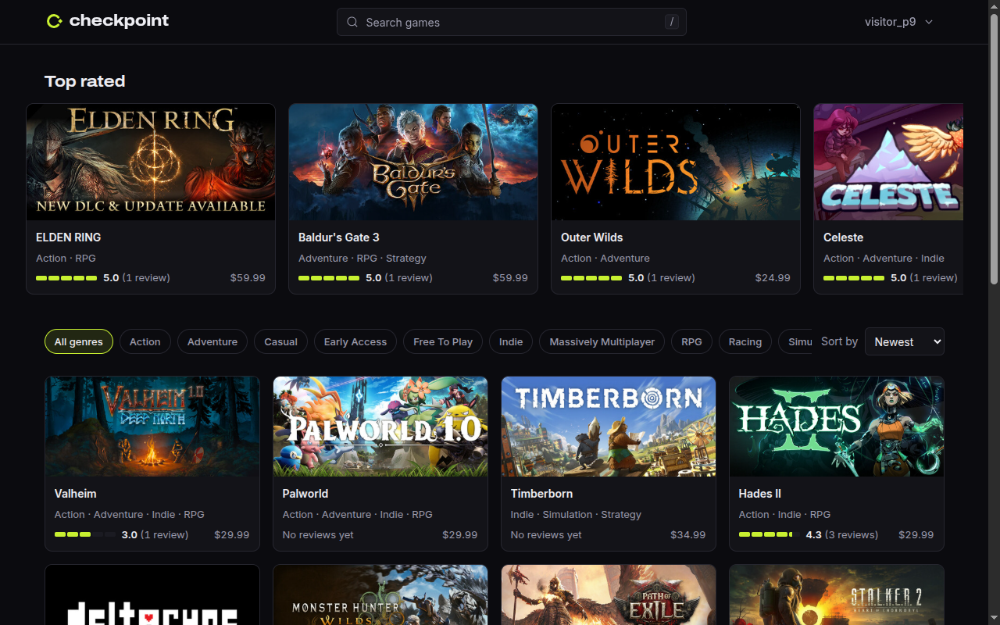

# Checkpoint

A game catalog API kept in sync with public Steam store data, with reviews, personal libraries
and a small React web app. NestJS, Prisma, PostgreSQL, Redis and BullMQ.

[](https://github.com/gustavoofranca/Checkpoint-NestJS/actions/workflows/ci.yml)
[](LICENSE)
[](.nvmrc)



No live demo is deployed; the [quick start](#quick-start) runs the whole stack with Docker.

## What it does

- Browse 211 Steam games: title search, genre filter, sort by newest, top rated or title, with
  cursor pagination
- Accounts with short-lived access tokens and rotating refresh tokens in an `HttpOnly` cookie
- One review per user and game (1 to 5 and a text), with the game's average kept up to date
- A personal library with a status per game: playing, backlog, completed, dropped
- A worker that syncs the catalog from Steam's store API daily or on an admin's request
- Public profiles, Prometheus metrics, structured logs and an OpenAPI document with Swagger UI

## Architecture

```
  Browser ──► web (nginx: static app, strict CSP)
                 │  /api
                 ▼
               api (NestJS) ──────────────┬──────────► PostgreSQL
                 │  enqueue sync           │              ▲
                 ▼                         ▼              │
               Redis ◄──────── cache, rate limits         │
                 │  BullMQ queue                          │
                 ▼                                        │
               worker (NestJS, no HTTP) ──────────────────┘
                 │
                 ▼
               Steam store API (appdetails, one request every 2 s)
```

The API and the worker are two processes built from one codebase. The API serves HTTP, reads
the catalog through a Redis cache and only enqueues syncs; the worker is the only process that
talks to Steam. PostgreSQL holds every record; Redis holds the cache, the rate-limit counters and
the queue, and losing it loses nothing that cannot be rebuilt. More in
[docs/ARCHITECTURE.md](docs/ARCHITECTURE.md).

## Quick start

Needs Docker with Compose v2, and `openssl` (Linux, macOS or WSL on Windows).

```sh
git clone https://github.com/gustavoofranca/Checkpoint-NestJS.git
cd Checkpoint-NestJS
cp .env.example .env

# Generate the passwords and the JWT signing key.
for name in POSTGRES_PASSWORD APP_DB_PASSWORD REDIS_PASSWORD JWT_SECRET; do
  sed -i.bak "s/^$name=.*/$name=$(openssl rand -hex 32)/" .env
done
# Local settings: the browser reaches the API through the web container (one proxy hop).
sed -i.bak -e 's#^CORS_ORIGINS=.*#CORS_ORIGINS=http://localhost:8080#' \
  -e 's/^TRUST_PROXY_HOPS=.*/TRUST_PROXY_HOPS=1/' -e 's/^ENABLE_DOCS=.*/ENABLE_DOCS=true/' .env
```

Then open `.env` and set `SEED_DEMO_PASSWORD` to a password of your choice, 12 to 128
characters. It becomes the password of the two demo accounts.

```sh
docker compose -f docker-compose.prod.yml up -d --build --wait
docker compose -f docker-compose.prod.yml --profile seed run --rm seed
```

The first command builds the images, applies the migrations and starts PostgreSQL, Redis, the
API, the worker and the web app. The second loads the bundled Steam snapshot, two demo accounts
and their reviews; it prints `Seeded 211 games and 12 genres; created 2 demo users and 16 demo
reviews.` and is safe to run again.

| URL | What |
| --- | --- |
| http://localhost:8080 | Web app. Sign in as `ana@checkpoint.test` or `bruno@checkpoint.test` with `SEED_DEMO_PASSWORD` |
| http://localhost:3000/api/v1/docs | Swagger UI, on the API's own port: the web app's Content Security Policy would block its inline styles |
| http://localhost:8080/api/v1/health/ready | Readiness: PostgreSQL and Redis |

To try the admin endpoints, promote an account and sign in again:

```sh
docker compose -f docker-compose.prod.yml run --rm api node dist/cli/promote-admin.js ana@checkpoint.test
```

`docker compose -f docker-compose.prod.yml down` stops everything; add `--volumes` to delete the
data.

For development, the API and the web app run on the host with Node 24, against PostgreSQL and
Redis from `docker compose up -d postgres redis` (the comments in [.env.example](.env.example)
describe each variable). The scripts of each package are listed in
[docs/CONVENTIONS.md](docs/CONVENTIONS.md#scripts-every-package-exposes).

## API overview

Every route is under `/api/v1`. Errors are [RFC 9457](https://www.rfc-editor.org/rfc/rfc9457)
Problem Details. The full contract is [api/openapi.json](api/openapi.json), served by Swagger UI
at `/api/v1/docs`.

| Method | Path | Access | Purpose |
| --- | --- | --- | --- |
| POST | `/auth/register`, `/auth/login` | Public | Create an account, sign in |
| POST | `/auth/refresh`, `/auth/logout` | Refresh cookie | New access token, sign out |
| GET | `/auth/me` | User | The signed-in account |
| GET | `/games`, `/games/{slug}`, `/genres` | Public | Catalog |
| GET | `/games/{slug}/reviews` | Public | Reviews of a game |
| GET, PUT, DELETE | `/games/{slug}/reviews/me` | User | Your review of a game |
| GET | `/me/library`, `/me/library/{gameId}` | User | Your library |
| PUT, DELETE | `/me/library/{gameId}` | User | Set or remove a game's status |
| GET | `/users/{username}` | Public | Public profile |
| POST, GET | `/admin/sync`, `/admin/sync/runs` | Admin | Start a sync, list runs |
| GET | `/health/live`, `/health/ready` | Public | Liveness, readiness |
| GET | `/metrics` | `METRICS_TOKEN` | Prometheus metrics; 404 when the token is not set |

List the top-rated games, three at a time:

```sh
curl -s 'http://localhost:8080/api/v1/games?sort=top_rated&limit=3'
```

Sign in and review a game:

```sh
token=$(curl -s http://localhost:8080/api/v1/auth/login \
  -H 'Content-Type: application/json' \
  -d '{"email":"bruno@checkpoint.test","password":"<SEED_DEMO_PASSWORD>"}' |
  sed -E 's/.*"accessToken":"([^"]+)".*/\1/')

curl -s -X PUT http://localhost:8080/api/v1/games/portal-2/reviews/me \
  -H "Authorization: Bearer $token" -H 'Content-Type: application/json' \
  -d '{"rating":5,"body":"Still the best co-op puzzle game."}'
```

## Engineering notes

**Authentication and refresh rotation.** Access tokens are HS256 JWTs valid for 15 minutes, held
in memory by the web app. Refresh tokens are opaque random values stored only as SHA-256 hashes,
sent in an `HttpOnly`, `Secure`, `SameSite=Strict` cookie. Each refresh claims the presented
token with a conditional update and issues its successor in the same transaction; presenting an
already-used token revokes the whole family. Passwords use Node's built-in Argon2id. See
[refresh-token.service.ts](api/src/modules/auth/tokens/refresh-token.service.ts),
[auth.service.ts](api/src/modules/auth/auth.service.ts) and
[ADR 0004](docs/adr/0004-rotating-opaque-refresh-tokens.md).

**Cursor pagination.** Every list is keyset-paginated on a total order, a sort key plus the id,
backed by a matching index. The cursor is the position of the last row served; the next page
asks for rows after it, with an extra bound so PostgreSQL can start an index scan there
([query plans](docs/query-plans/catalog.md)). No offsets, no count queries. See
[cursor.ts](api/src/common/pagination/cursor.ts),
[games.service.ts](api/src/modules/games/games.service.ts) and
[ADR 0005](docs/adr/0005-cursor-pagination.md).

**Cache invalidation.** Catalog reads are cache-aside in Redis under versioned keys
(`games:v<n>:...`). A review write or a sync runs `INCR games:version` after its transaction
commits, which makes every older entry unreachable at once. A Redis failure never fails a request:
the API logs it and reads PostgreSQL. See [cache.service.ts](api/src/redis/cache.service.ts),
[cache.e2e-spec.ts](api/test/cache.e2e-spec.ts) and
[ADR 0007](docs/adr/0007-versioned-cache-keys.md).

**Catalog sync.** The worker follows a curated list of 211 Steam app ids, one request every two
seconds, with a fixed host, timeouts, a response size cap, retries with backoff and zod validation
of every payload. A unique index on a lock column, tied to the run status by a CHECK constraint,
lets PostgreSQL hold one running sync at a time, so two simultaneous starts cannot both run. See
[steam-client.ts](api/src/modules/sync/steam/steam-client.ts),
[sync-runner.service.ts](api/src/modules/sync/sync-runner.service.ts),
[ADR 0009](docs/adr/0009-steam-appdetails-and-curated-list.md) and
[ADR 0010](docs/adr/0010-separate-worker-process.md).

**Authorization test matrix.** Every route that needs an access token is called without a token,
with a malformed one and with an expired one, and must answer 401. The test compares that table
with the OpenAPI document, so a new route that is in neither the protected nor the public list
fails the build. Ownership (another user's library or review) and role checks (a USER on an admin
route answers 403) have their own tests, listed route by route in the
[matrix](api/test/README.md#authorization-matrix). See
[authorization.e2e-spec.ts](api/test/authorization.e2e-spec.ts) and
[docs/SECURITY.md](docs/SECURITY.md).

## Testing

```sh
cd api && npm run test:cov   # unit and e2e tests, against PostgreSQL and Redis in Docker
cd web && npm test           # tests in jsdom
```

The API has 396 tests: unit tests beside the code, and e2e tests that go through HTTP against a
real PostgreSQL and Redis. Coverage is 98.05% of lines and 86.28% of branches, with 85% enforced
for both. The web app has 15 tests (components, the session store and error handling). CI also runs lint, type checks, `npm audit`, a
secret scan, CodeQL, a drift check of the committed OpenAPI document and a build of both
production images. How the tests are organised: [api/test/README.md](api/test/README.md).

## Performance

```sh
./load/run.sh   # needs the development stack, a seeded database and a build of the API
```

[k6](load/catalog.js) reads every game page and a set of list queries, first once each right
after the cache is invalidated (served by PostgreSQL), then at 200 requests a second for 30
seconds (served by Redis). On the seed dataset, on an Intel Core i5-1240P:

| Scenario | Requests | p95 | Target | Errors |
| --- | --- | --- | --- | --- |
| Uncached | 258 | 31.65 ms | under 200 ms | 0 |
| Cached | 6001 | 2 ms | under 50 ms | 0 |

## Security

Passwords are hashed with Argon2id; access tokens are short-lived and refresh tokens rotate with
reuse detection. Every input is validated and every protected route has authorization tests.
Credential routes are rate limited and fail closed. The web app runs under a strict Content
Security Policy, with no token in `localStorage`. The production containers run as non-root on
read-only file systems, and the API connects to PostgreSQL with a role that cannot change the
schema. Logs redact credentials. The rules are in [docs/SECURITY.md](docs/SECURITY.md), and the
rule-by-rule review with the enforcing code and the proving test is in
[docs/SECURITY-REVIEW.md](docs/SECURITY-REVIEW.md). To report a vulnerability, see
[SECURITY.md](SECURITY.md).

## Decisions

| ADR | Decision |
| --- | --- |
| [0001](docs/adr/0001-oxc-emits-decorator-metadata-in-tests.md) | Tests rely on Vitest's Oxc transform for decorator metadata |
| [0002](docs/adr/0002-uuid-v7-primary-keys.md) | UUID v7 primary keys generated by Prisma Client |
| [0003](docs/adr/0003-native-argon2id-password-hashing.md) | Password hashing with Node's built-in Argon2id |
| [0004](docs/adr/0004-rotating-opaque-refresh-tokens.md) | Short-lived JWT access tokens and rotating opaque refresh tokens in a cookie |
| [0005](docs/adr/0005-cursor-pagination.md) | Keyset (cursor) pagination for every list |
| [0006](docs/adr/0006-denormalized-ratings.md) | Denormalized rating columns, recomputed under a row lock |
| [0007](docs/adr/0007-versioned-cache-keys.md) | Cache-aside with versioned keys |
| [0008](docs/adr/0008-rate-limiting.md) | Rate limits in Redis, failing closed on credential routes |
| [0009](docs/adr/0009-steam-appdetails-and-curated-list.md) | Steam's appdetails endpoint, over a curated list of games |
| [0010](docs/adr/0010-separate-worker-process.md) | A separate worker process for the catalog sync |
| [0011](docs/adr/0011-metrics-error-reporting-and-audit.md) | Metrics, error reporting and audit logs |

## How this was built

The project was built with Claude Code, phase by phase, under the rules in
[CLAUDE.md](CLAUDE.md) and [docs/](docs/): a written spec, binding security rules, a list of known
failure modes of AI-written code with a guard for each, and acceptance criteria per phase. The
author reviewed each phase before it was merged. The log of each phase is in
[docs/PROGRESS.md](docs/PROGRESS.md).

## Limitations and next steps

- The catalog is a fixed list of 211 games; prices are US list prices in USD.
- Steam does not publish its rate limit; two seconds between requests is a margin, not a
  guarantee.
- Search is a substring match on the title, not a ranked full-text search.
- The worker is a single process; running two would need a different way to recover runs cut
  short.
- Five failed logins lock an account's login for 15 minutes, which someone else can trigger on
  purpose ([ADR 0008](docs/adr/0008-rate-limiting.md)).
- Admin actions have no UI; they are API only.

## License

[MIT](LICENSE). This project is not affiliated with, endorsed by or sponsored by Valve
Corporation or Steam. Game names, descriptions and images belong to their owners and are shown
as served by the public Steam store API.
